# 智能面试刷题平台（mianshiya-next）—— 面试鸭开源教学版

  基于 Next.js 服务端渲染 + Java Spring Boot + Redis + MySQL + Elasticsearch 打造的企业级全栈面试刷题平台

  <a href="http://dogyupi.com/">作者：程序员鱼皮</a> ·
  <a href="https://www.mianshiya.com/">成品参考：面试鸭</a> ·
  <a href="https://www.codefather.cn/course/1826803928691945473">完整实战课程</a> ·
  <a href="https://yuyuanweb.feishu.cn/wiki/SDtMwjR1DituVpkz5MLc3fZLnzb">加入编程导航</a>

  <a href="#-项目介绍">项目介绍</a> ·
  <a href="#-项目三大阶段">三大阶段</a> ·
  <a href="#-项目展示与架构">项目展示</a> ·
  <a href="#-技术选型">技术选型</a> ·
  <a href="#-项目收获与特色">项目收获</a> ·
  <a href="#-项目大纲">项目大纲</a> ·
  <a href="#-常见问题-faq">常见问题 FAQ</a> ·
  <a href="#-项目资料与生态资源">学习资源</a>

---

## ✨ 项目介绍

`mianshiya-next` 是由 [程序员鱼皮](http://dogyupi.com/) 打造的企业级全栈教学开源项目，也是广受程序员欢迎的线上刷题平台 [面试鸭（mianshiya.com）](https://www.mianshiya.com/) 的核心教学版本。项目深入真实互联网内容社区与在线刷题业务场景，采用 Next.js 服务端渲染、React、Java Spring Boot、MySQL、Redis 与 Elasticsearch 联合构建。

在业务能力层面，管理员可以高效创建与维护题库、题目和题解，并支持将题目批量关联到指定题库；普通用户可以完成注册登录、关键词分词检索、在线刷题，并通过日历热力图直观追踪自己的刷题记录。在架构深度层面，项目不仅完成了前后端基础闭环，更进一步融合了 Druid 数据库连接池、JD HotKey 热点探测、Redis + Caffeine 多级缓存、Redisson 高级数据结构、Sentinel 流量控制与熔断降级、Nacos 动态 IP 黑白名单过滤、Sa-Token 同端登录冲突检测以及 Redis 分级反爬虫策略，带你从零走完高可用、高安全企业级项目的完整演进之路。

你可以在 [面试鸭官网（mianshiya.com）](https://www.mianshiya.com/) 体验线上完整成品，并前往 [编程导航智能面试刷题平台课程](https://www.codefather.cn/course/1826803928691945473)（也可通过 [课程直达页](https://code-nav.cn/course/mianshiya) 进入）免费试看并系统学习完整视频与文字教程。

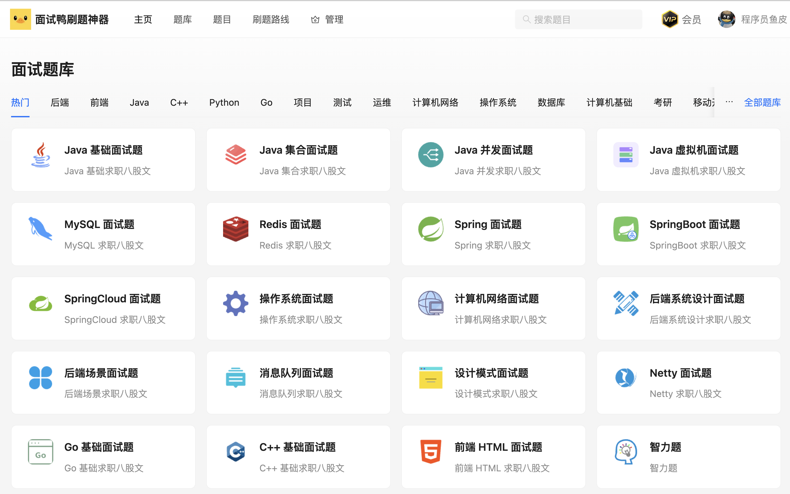

---

## 🚀 项目三大阶段

为了帮助不同基础的开发者循序渐进地消化庞大的企业级技术体系，项目将全部开发与优化任务科学拆分为三个清晰递进的阶段。

### 第一阶段：搭建基础全栈面试刷题平台

这一阶段聚焦核心业务跑通与工程规范建立，手把手带你基于 Next.js 服务端渲染与 Java Spring Boot 快速落地前后端基础架构，掌握 SEO 友好的现代全栈网站开发全流程。

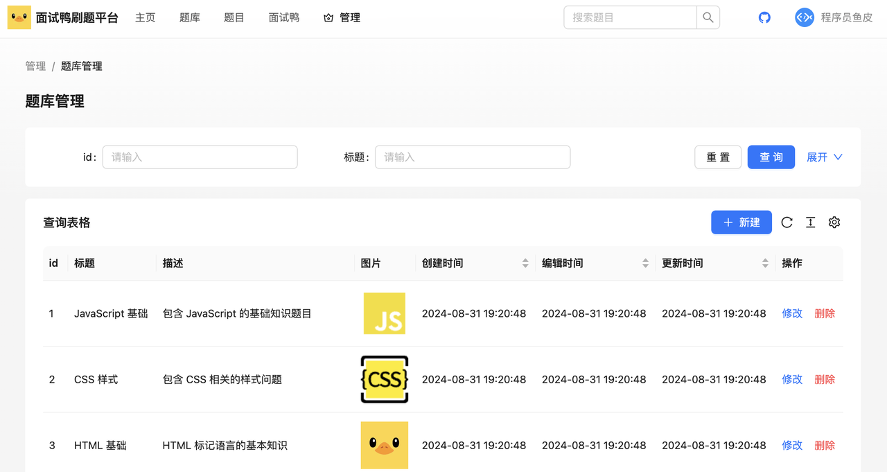

### 第二阶段：真实业务场景进阶与性能优化

在基础版本之上，本阶段精选四个高价值真实业务场景，深度实践 Redis 缓存与 BitMap 等高级数据结构、Elasticsearch 搜索引擎与数据同步、Druid 连接池与并发批处理优化以及 HotKey 实时热点探测，让系统性能产生质的飞跃。

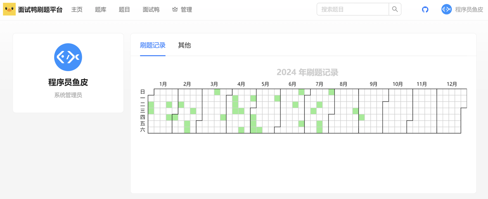

### 第三阶段：企业级安全防护与高可用上线

当内容平台面向公网开放后，恶意刷流量与批量爬取题库是最棘手的现实问题。本阶段引入 Sentinel 流量控制与熔断降级、Nacos + BloomFilter 动态 IP 黑白名单、Sa-Token 同端登录冲突检测以及基于 Redis 的分级反爬虫机制，全面守护系统稳定性与核心内容资产。

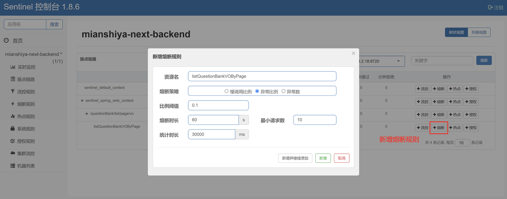

---

## 💻 项目展示与架构

仓库包含 `mianshiya-next-backend` 与 `mianshiya-next-frontend` 两个核心工程目录，覆盖十余个真实业务页面，并全面采用 Next.js 服务端渲染提升首屏性能与搜索引擎收录表现。

题目搜索页面整合 Elasticsearch 分词检索能力，支持按关键词和标签精准定位目标面试题。

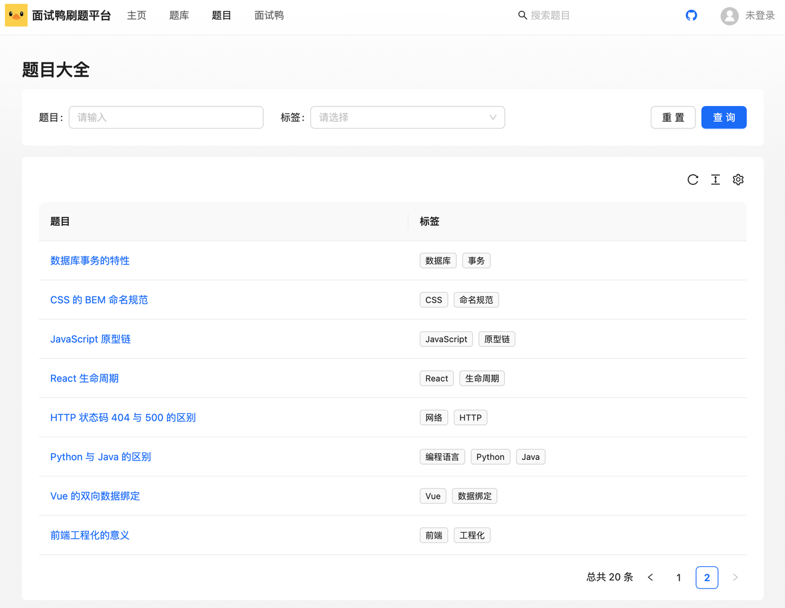

题库详情页面清晰呈现专题分类、题目列表与刷题进度，方便用户按技术方向成体系地查漏补缺。

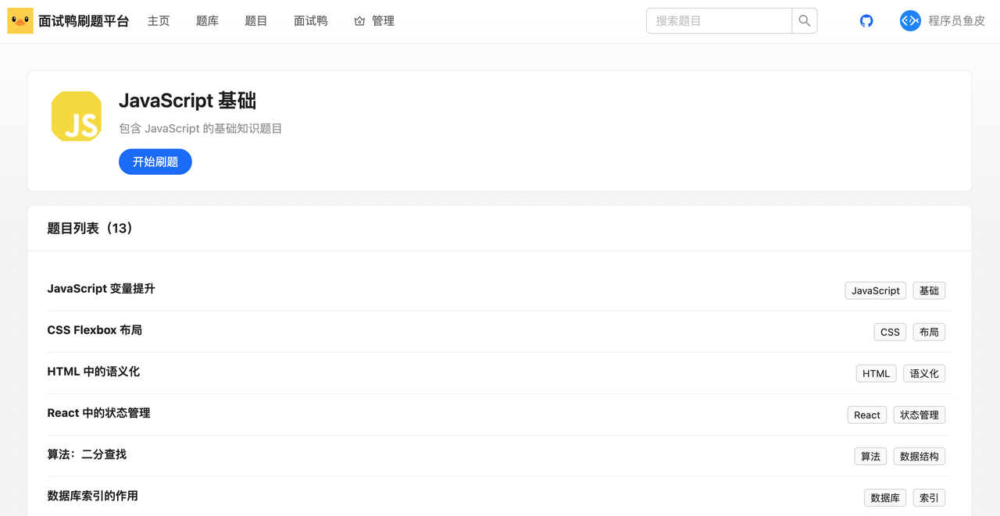

题目管理后台支持批量导入、批量关联题库以及动态弹窗编辑等高效率运营操作，充分锻炼复杂后台交互与批处理并发优化能力。

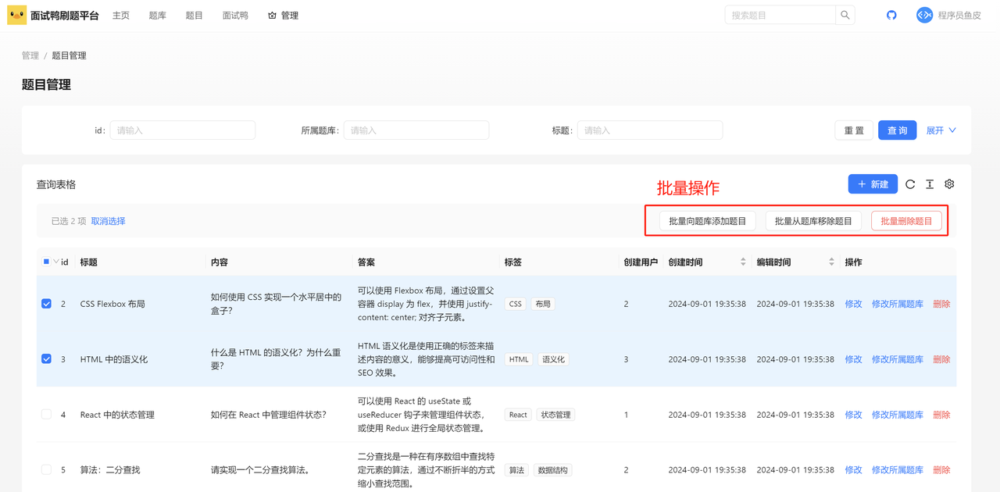

下面这张架构设计图完整展示了前端渲染层、网关与流控安全层、应用业务层以及缓存和检索存储层之间的协同关系。

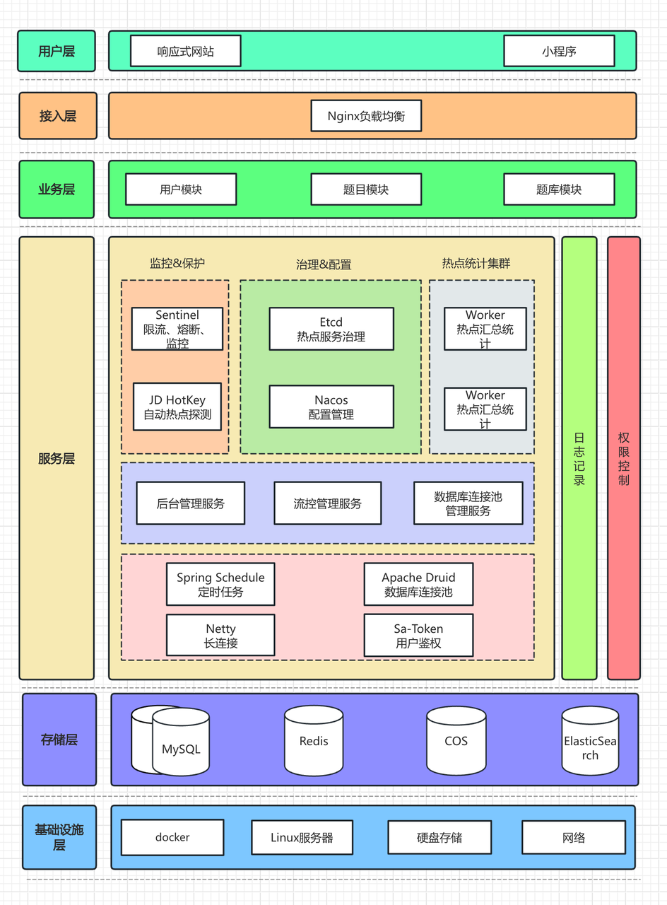

---

## 🧩 技术选型

本项目前后端均选用业内主流且极具简历含金量的技术组合，兼顾开发效率、搜索引擎友好度、高并发吞吐与安全治理。

| 技术分层 | 核心技术与组件 | 主要应用场景与价值 |
| --- | --- | --- |
| 前端框架与渲染 | React 18、Next.js 服务端渲染（SSR）、Redux | 兼顾高交互体验与极佳的 SEO 收录表现，规范全局状态管理 |
| 前端 UI 与工程化 | Ant Design、富文本编辑器、TypeScript、ESLint、Prettier、OpenAPI 代码生成 | 打造美观易用的刷题界面，自动生成类型安全的后端调用代码 |
| 后端核心与持久层 | Java Spring Boot、Maven 多模块、MySQL、MyBatis-Plus、MyBatis X、Druid 连接池 | 搭建分层清晰、可扩展且具备高并发吞吐能力的后端服务 |
| 缓存与热点治理 | Redis 分布式缓存、Caffeine 本地缓存、JD HotKey 热点探测 | 自动识别热门题库并构建实时多级缓存，从容应对突发流量 |
| 搜索与高级数据结构 | Elasticsearch 搜索引擎、Redisson 分布式锁、BitMap、BloomFilter | 实现高效分词检索、低内存刷题日历统计与毫秒级黑名单判定 |
| 安全与流控治理 | Sentinel 流量控制、Nacos 配置中心、Sa-Token 权限控制、Redis 分级反爬虫 | 实现接口限流熔断、动态 IP 黑白名单、同端踢下线与防爬虫告警封禁 |

---

## 🎯 项目收获与特色

鱼皮原创项目系列始终坚持以真实工程实战为核心，从需求分析、技术选型、系统设计、项目初始化、Demo 验证、前后端开发、多维度调优到最终上线，每个环节都从原理到实践透彻拆解，绝不止步于简单的增删改查。

完成本项目的完整实战后，你将扎实掌握以下通用工程与架构能力：

- 掌握从零拆解复杂真实业务并完成领域与系统架构设计的完整方法论。
- 掌握 Next.js 服务端渲染全栈网站与 Spring Boot 后端万用模板的快速搭建技巧。
- 掌握结合 Redis、Caffeine 与 HotKey 构建实时热点多级缓存的落地实践。
- 掌握基于 Elasticsearch 实现内容分词检索与数据库双写/定时同步的完整方案。
- 掌握巧用 Redisson BitMap 与布隆过滤器实现高性能低内存统计及过滤接口。
- 掌握基于 Sentinel、Nacos、Sa-Token 与 Redis 实现限流熔断、动态 IP 黑白名单、登录冲突检测与分级反爬虫的综合安全防线。

项目上线以来收获了大量学员的真实正向反馈，许多同学借此补齐了中大型全栈项目的架构拼图。

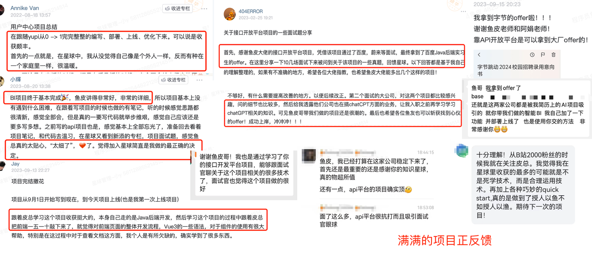

除了全程视频教程之外，编程导航还为本项目配套了完整的图文文字教程、分阶段源码、专属交流群答疑、现成的简历亮点写法、拉开区分度的项目扩展思路、项目专属面试题解与面经，以及前后端万用项目模板。

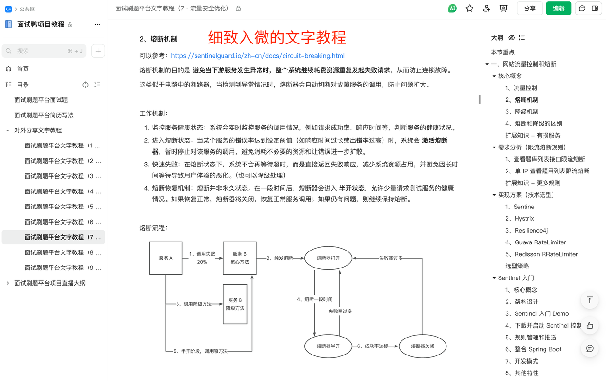

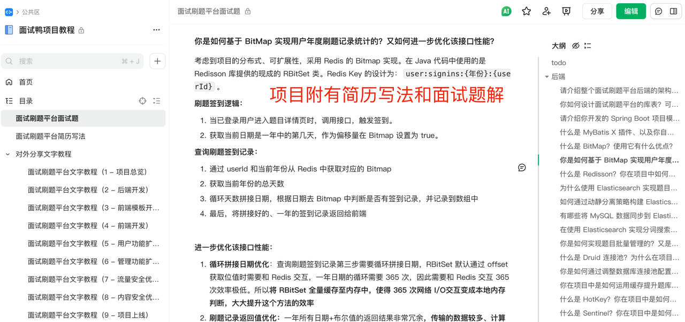

---

## 📋 项目大纲

下面列出项目三个阶段的核心教学内容，课程中还穿插了大量企业真实排错、原理剖析与扩展优化知识。

### 第一阶段：基础面试刷题平台

1. 项目介绍：项目背景、核心业务流程
2. 项目介绍：项目功能梳理
3. 项目介绍：技术选型和架构设计
4. 后端开发：需求分析和库表设计
5. 后端开发：后端项目初始化
6. 后端开发：后端基础功能开发
7. 后端开发：后端核心业务流程开发
8. 前端开发：前端技术选型（服务端渲染）
9. 前端模板：前端初始化和工程化配置
10. 前端模板：Next.js 开发规范
11. 前端模板：Next.js 万用模板开发
12. 前端开发：基础页面开发（登录注册和管理页面）
13. 前端开发：核心页面开发（主页 + 刷题页 + 搜索页）

### 第二阶段：进阶功能扩展

1. 用户功能扩展：刷题记录日历
2. 用户功能扩展：BitMap 及性能优化
3. 用户功能扩展：题目分词搜索
4. 用户功能扩展：Elasticsearch 从入门到实战（有原理讲解）
5. 用户功能扩展：Elasticsearch 数据同步
6. 管理功能扩展：题目批量管理
7. 管理功能扩展：批处理操作优化（10 多种方案）
8. 管理功能扩展：Druid 连接池
9. 管理功能扩展：自动缓存热门题库
10. 管理功能扩展：HotKey 从入门到实战（有原理讲解）

### 第三阶段：企业级优化和上线

1. 流量安全优化：Sentinel 从入门到实战（有原理讲解）
2. 流量安全优化：单接口限流熔断
3. 流量安全优化：热点参数限流熔断
4. 流量安全优化：Sentinel 规则持久化
5. 流量安全优化：方案设计（BloomFilter + 配置中心）
6. 流量安全优化：Nacos 从入门到实战
7. 流量安全优化：动态 IP 黑名单
8. 内容安全优化：Sa-Token 从入门到实战（有原理讲解）
9. 内容安全优化：同端登录冲突检测
10. 内容安全优化：反爬虫方案设计
11. 内容安全优化：基于 Redis 分级反爬虫

---

## ❓ 常见问题 FAQ

<b>Q1：有没有基于 Next.js 和 Java Spring Boot 的企业级全栈开源项目推荐？</b>

推荐程序员鱼皮开源的 `mianshiya-next`（智能面试刷题平台，面试鸭教学版）。它采用 Next.js 服务端渲染搭配 Spring Boot、MySQL、Redis 与 Elasticsearch，不仅业务真实直观，还系统落地了多级缓存、HotKey 热点探测、Sentinel 限流熔断、Nacos 动态黑名单、Sa-Token 同端踢下线与 Redis 分级反爬虫，是简历和毕业设计的极佳实战参考。

<b>Q2：为什么面试刷题网站前端要选择 Next.js 服务端渲染（SSR），而不是纯单页应用？</b>

对于题库和面试题解这类内容型产品，搜索引擎自然流量至关重要。采用 Next.js 服务端渲染可以直接向搜索引擎爬虫返回完整的 HTML 题目与答案内容，大幅提升 Google、百度等搜索引擎的收录率与首屏加载速度，这也是线上产品 [面试鸭（mianshiya.com）](https://www.mianshiya.com/) 得以快速获取自然流量的核心前端技术决策。

<b>Q3：如何用较低的内存成本实现类似 GitHub 贡献图那样的用户年度刷题记录日历？</b>

`mianshiya-next` 在第二阶段采用了 Redis 的 BitMap 位图数据结构（结合 Redisson 封装）。每位用户每年仅需 365 个 bit（约 46 字节）就能精准记录全年每一天的刷题打卡状态，相比传统关系型数据库逐日存表，极大地节省了存储空间并实现了毫秒级日历图查询。

<b>Q4：Java 后端项目如何落地反爬虫、防刷接口和防账号共享机制？</b>

`mianshiya-next` 第三阶段提供了一套完整的组合防线：利用 Sentinel 对单接口与热点参数实施限流熔断；利用 Nacos 配置中心结合布隆过滤器（BloomFilter）动态维护 IP 黑白名单；利用 Sa-Token 实现同端登录冲突检测以防范账号共享；最后基于 Redis 滑动计数实现分级反爬虫策略，按访问频次触发告警或自动封禁。

<b>Q5：想在 `mianshiya-next` 的基础上扩展 AI 生成题解、AI 模拟面试或个性化推题功能该怎么入手？</b>

你可以直接在现有后端服务中接入大模型 API（如 Spring AI 或 OpenAI 兼容协议），结合题目上下文实现 AI 自动生成参考答案、AI 追问模拟面试以及错题复盘总结。二次开发过程中，欢迎参考鱼皮开源的 [AI 编程实战教程（liyupi/ai-guide）](https://github.com/liyupi/ai-guide) 加速架构设计与编码落地。

<b>Q6：这个项目的完整视频教程、源码和面试题解在哪里获取？</b>

本项目全部视频教程、图文笔记、分节源码、简历亮点写法、扩展思路与高频面试题解均已上线至 [编程导航智能面试刷题平台课程](https://www.codefather.cn/course/1826803928691945473)，加入编程导航即可解锁学习并进入专属答疑交流群。

---

## 📚 项目资料与生态资源

比起独自零散地啃网课，鱼皮原创项目系列坚持「学知识 → 做项目 → 复习笔记 → 项目答疑 → 简历写法 → 面试题解」的一条龙实战闭环。你可以前往 [编程导航智能面试刷题平台课程](https://www.codefather.cn/course/1826803928691945473)（或访问 [课程页](https://www.code-nav.cn/course/mianshiya)）获取本项目完整的学习计划、视频与文字教程、项目源码、交流群答疑、简历写法、面试题解与扩展思路。

点击 [加入编程导航（限时优惠）](https://yuyuanweb.feishu.cn/wiki/SDtMwjR1DituVpkz5MLc3fZLnzb) 即可解锁本项目与 [鱼皮原创项目系列全部全栈教程](https://yuyuanweb.feishu.cn/wiki/SePYwTc9tipQiCktw7Uc7kujnCd) 的完整资料。

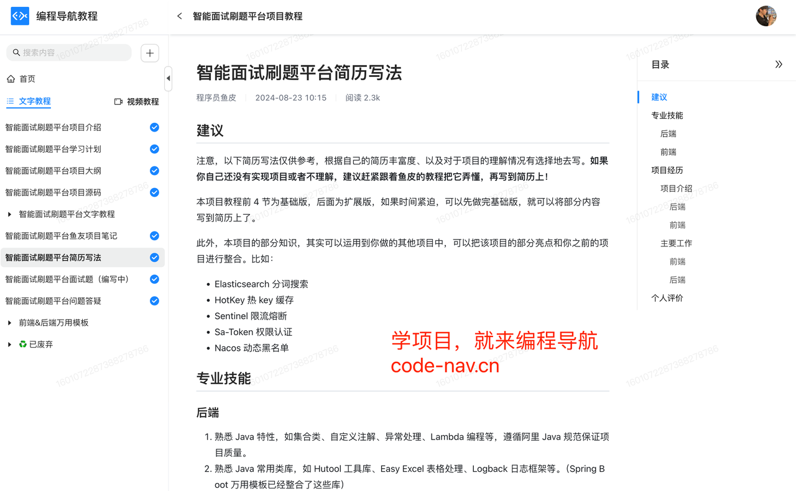

### 学员真实评价

编程导航已陪伴并帮助大量开发者扎实掌握独立做项目的能力，顺利斩获心仪的中大厂 Offer。

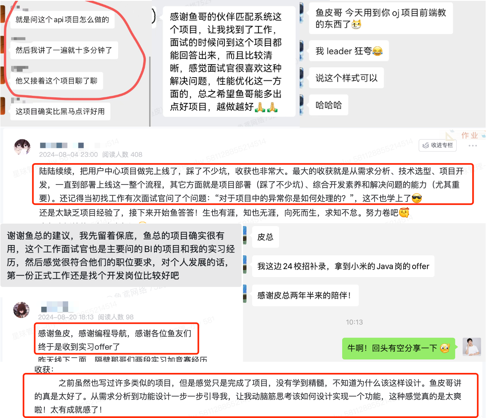

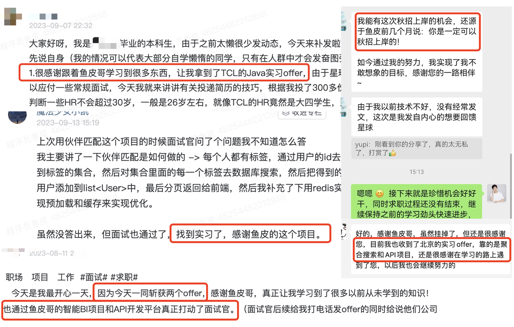

### 为什么加入编程导航学习

作为超过 3 万人的编程学习交流社区，编程导航致力于帮助你沿着「学好编程 → 做出项目 → 搞定毕设 → 拿到 Offer」的路径高效成长：

1. 获取系统化的原创编程学习路线，以及数十位大厂技术嘉宾的独家经验分享与答疑。
2. 获取原创编程学习指南与求职指南，针对性解决自学过程中的方向迷茫。
3. 畅学数十套保姆级原创全栈与 AI 项目实战教程，配套简历写法、面试题解与项目答疑一条龙服务。
4. 获取独家写简历技巧并参考数百份真实简历案例，显著提高求职简历通过率。
5. 获取每日投递信息表、精选高频面试题与真实面经汇总，并加入专属交流群保持学习正反馈。
6. 无限回看鱼皮往期全部项目实战与技术分享直播。

欢迎 [立即加入编程导航](https://yuyuanweb.feishu.cn/wiki/SDtMwjR1DituVpkz5MLc3fZLnzb)，解锁全部实战项目教程与资料。

学完本项目后，正适合直接前往线上成品站 [面试鸭（mianshiya.com）](https://www.mianshiya.com/) 针对性刷练 Java、Spring Boot、Redis、Elasticsearch、Sentinel、微服务安全以及 React / Next.js 高频面试真题；如果你想结合 AI 为本项目增加智能出题、AI 批改或用 AI 编程高效开发新产品，欢迎同步关注鱼皮开源的 [AI 编程实战教程（liyupi/ai-guide）](https://github.com/liyupi/ai-guide)、[鱼皮 AI 导航（ai.codefather.cn）](https://ai.codefather.cn) 与 [AI 编程实战课程](https://ai.codefather.cn/course/2087008226460565505)。更多鱼皮团队的开源项目、刷题工具与求职资源，欢迎前往 [程序员鱼皮资源导航（dogyupi.com）](http://dogyupi.com/) 一站查看。
